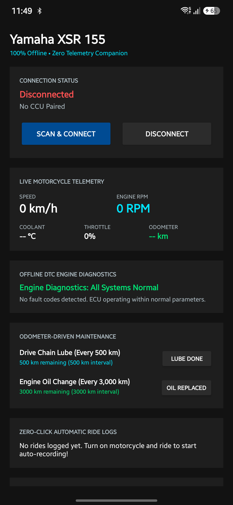

# Yamaha XSR 155 Companion

[](LICENSE)
[](release/xsr-companion-v1.0.apk)
[-brightgreen.svg)](#privacy-guarantee)
[-orange.svg)](app/build.gradle)

An ultra-lightweight, 100% offline, privacy-first Android companion app for the **Yamaha XSR 155** (and compatible **MT-15** / **YZF-R15 V3/V4** motorcycles with the Yamaha CCU / `SCCU1_ICE` system).

Replaces the bloated official Yamaha Motor On / Y-Connect application (90.7 MB, cloud logins, Sentry/Firebase tracking, AWS telemetry) with a lean **50 KB** offline alternative that communicates directly with your motorcycle over Bluetooth Low Energy (BLE).

---

<p align="center">
  
</p>

---

## Features

### ⏱️ Zero-Click Automatic Ride Tracking & GPX Export
* **Completely Hands-Free**: Starts logging automatically the instant the phone connects to your bike's CCU over BLE.
* **Synchronized Telemetry**: Records GPS track points every second paired with motorcycle CAN telemetry:
  * **Wheel Speed (km/h)** (direct from the wheel sensor, zero GPS latency)
  * **Engine RPM**
  * **Throttle Opening Angle (%)**
  * **Coolant Temperature (°C)**
* **Smart Discard Filter**: If movement was `< 50 meters` (e.g., turning the key on/off in the garage), the trip is automatically discarded to keep your ride history clean.
* **Standard GPX 1.1 Exporter**: Automatically generates standard `.gpx` files with Garmin TrackPoint extensions (`<gpxtpx:cad>` for RPM, `<gpxtpx:temp>` for Coolant Temp, `<speed>` for wheel speed). Export directly to **Strava**, **Garmin Connect**, **Relive**, **Google Earth**, or telemetry video overlays.

### 🔧 Offline DTC Diagnostic Trouble Code Reader
* **20+ Offline Yamaha 155cc Codes**: Decodes check engine status (`0x0300000D`) and diagnostic fault codes (`0x02000009`) straight from the ECU.
* **Plain-English Explanations**: Diagnoses issues like DTC 12 (Crank sensor), DTC 19 (Sidestand switch), DTC 21 (Coolant temp sensor), DTC 46 (Charging voltage), and DTC 84 (VVA solenoid) without needing a dealer OBD-II scanner.

### 🛠️ Odometer-Driven Maintenance Tracker
* **Real Motorcycle Odometer**: Automatically reads the bike's actual cumulative odometer (`0x0200000A`) over BLE.
* **Configurable Intervals**:
  * **Drive Chain Clean & Lube**: Every 500 km
  * **Engine Oil (Yamalube 10W-40)**: Every 3,000 km
  * **Oil Filter Element**: Every 6,000 km
  * **Brake Pads & Fluid**: Every 5,000 km
  * **Spark Plug (NGK MR8E9)**: Every 10,000 km
  * **Air Cleaner Element**: Every 12,000 km
  * **Coolant Flush**: Every 20,000 km
* **One-Tap Reset**: Tap "Lube Done" or "Oil Replaced" to log service at your current odometer.

### 📱 Cluster Meter Synchronization
* **Phone Battery Sync**: Relays phone battery percentage to the bike's LCD gauge every 1000 ms via packet `0x058A`.
* **Clock Sync**: Auto-syncs your motorcycle's instrument cluster clock to phone time.
* **Incoming Call Alerts**: Signals incoming and missed phone calls to the meter's call indicator via packet `0x058B`.

### 📍 Last Parked Location (Offline)
* Captures GPS coordinates precisely at the moment of BLE disconnect (ignition key turned off).
* Includes a one-tap "Navigate to Motorcycle" button to launch navigation directly back to your parking spot.

---

## Privacy Guarantee

```
No INTERNET Permission.
No Analytics.
No Trackers.
No Cloud Accounts.
No Telemetry Uploads.
```

The app manifest declares **zero** network access:
```xml
<!-- In AndroidManifest.xml: android.permission.INTERNET is completely absent -->
```
All ride logs, GPS tracks, diagnostic logs, and maintenance records remain exclusively inside your phone's encrypted SQLite database (`xsr_rides.db`).

---

## Comparison: Official Yamaha App vs. XSR Companion

| Metric | Official Yamaha Motor On App | XSR Companion App |
| :--- | :---: | :---: |
| **APK File Size** | **90.7 MB** | **50 KB** (0.05 MB) |
| **Internet Access** | Required (`android.permission.INTERNET`) | **None** (100% Offline) |
| **Cloud Analytics / Trackers** | Sentry, Firebase, Gigya, Google Measurement | **Zero** |
| **GPX / CSV Ride Export** | Locked in Yamaha Cloud Database | **Instant One-Click Export** |
| **Fault Diagnostics** | Vague warning, visit dealer | **Plain-English DTC code reader** |
| **Maintenance** | Cloud / dealer appointment system | **Real Odometer-Driven local tracker** |
| **Memory Footprint**| ~180 MB RAM | **~18 MB RAM** |

---

## Reverse-Engineered Protocol

The Yamaha CCU (SCCU1 ICE) uses the Nordic UART Service (NUS):

* **Service UUID**: `6E400001-B5A3-F393-E0A9-E50E24DCCA9E`
* **RX Characteristic (Write)**: `6E400002-B5A3-F393-E0A9-E50E24DCCA9E`
* **TX Characteristic (Notify)**: `6E400003-B5A3-F393-E0A9-E50E24DCCA9E`

For full byte-level packet layouts, checksum algorithms, and CAN slot identifiers, see:
📖 [**Full Reverse-Engineered BLE Protocol Specification**](docs/yamaha_xsr_ble_spec.md)

---

## Installation

### Option 1: Install Prebuilt APK
Download the signed debug APK directly from this repository:
👉 [**Download xsr-companion-v1.0.apk (50 KB)**](release/xsr-companion-v1.0.apk)

Or sideload via ADB:
```bash
adb install -r release/xsr-companion-v1.0.apk
```

### Option 2: Build From Source
Requirements: Android SDK (API 34), JDK 17.

```bash
git clone https://github.com/agasthya36/xsr-companion.git
cd xsr-companion
./gradlew assembleDebug
```
The APK will be generated at `app/build/outputs/apk/debug/app-debug.apk`.

---

## Compatibility
* **Yamaha XSR 155** (All model years with CCU)
* **Yamaha MT-15 V2** (Y-Connect CCU)
* **Yamaha YZF-R15 V3 / V4 / R15M** (Y-Connect CCU)
* **Yamaha Aerox 155 / NMAX 155** (SCCU1 profile)

---

## License
Licensed under the [Apache License, Version 2.0](LICENSE).
Yamaha, XSR 155, MT-15, and Y-Connect are trademarks of Yamaha Motor Co., Ltd. This project is an independent open-source reverse-engineering research project and is not affiliated with or endorsed by Yamaha Motor Co., Ltd.
